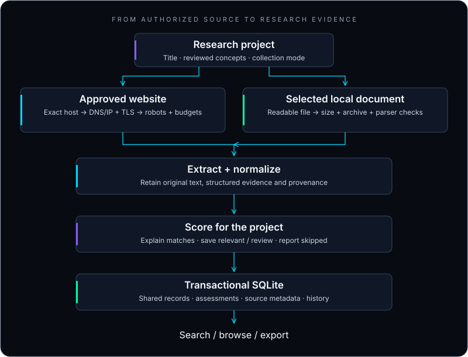

<p align="center">
  
</p>

<a name="spiderdeck"></a>
<h1 align="center">SPIDERDECK</h1>
<p align="center"><strong>Collect intelligently. Investigate locally.</strong></p>
<p align="center">A local-first Python research intelligence engine.<br />Collect from authorized websites and local documents. Keep the evidence, context and search on your machine.</p>

<p align="center">
  
</p>

<p align="center">
  <a href="#installation"><strong>Get started →</strong></a> ·
  <a href="#see-it-in-action">Terminal preview</a> ·
  <a href="#research-workflow">Research workflow</a> ·
  <a href="SECURITY.md">Security model</a> ·
  <a href="MANUAL_TESTING.md">macOS guide</a>
</p>

---

## Research is scattered. Your evidence does not have to be.

A useful paragraph lives on a university website. The supporting data is in a spreadsheet. Another lead is buried in a PDF. Collecting them is only the beginning: you still need to find, compare and trace what you saved.

**SpiderDeck brings those sources into a local research workspace.** Start with a topic, choose permitted sources, inspect explainable relevance matches, and search or export the underlying evidence. Quick collection and unfiltered document import remain available when you do not need a project.

This is a terminal application built for careful collection and investigation. It does not generate research conclusions, verify citations or bypass access restrictions.

## Inside the deck

| Collection & evidence | Organization & investigation |
| :--- | :--- |
| **Authorized static collection** — HTML/XHTML and public JSON GET endpoints, with exact-host approval, bounded preflight and separate start confirmation. | **Research projects** — reviewed keywords, exclusions, editable settings, archiving and confirmed deletion. |
| **Focused crawling** — Strict, Balanced and Discovery modes prioritize promising links within the approved scope. | **Explainable relevance** — local lexical scores show matches, missing concepts, exclusions and scoring components. |
| **Local document import** — native macOS file selection, validation and extraction with source locations. | **SQLite persistence** — transactional writes, stable identifiers, exact-copy references and schema-aware migrations. |
| **Structured evidence** — available headings, paragraphs, lists, tables and source-declared metadata, alongside original extracted text. | **Project search** — source/type/date filters, stable pagination and optional runtime-detected FTS5. |
| **Security diagnostics** — offline self-check, sanitized collection audits and adversarial regression tests. | **Readable findings** — paginated evidence views; project Markdown, JSON and formula-protected CSV exports. |
| **Incremental project collection** — safe ETag/Last-Modified validators and permitted 304 reuse, after fresh checks. | **Offline supervisor comparison** — separate TF-IDF research-idea ranking with bounded inputs and match explanations. |

**Import formats:** PDF · DOCX · XLSX · CSV · JSON · TXT · Markdown · HTML.

**Available:** the features above. **Optional:** FTS5 when SQLite supports it; native picker backends when available. **Evaluation-stage:** topic heuristics and coverage labels have synthetic evaluation only. **Not implemented:** semantic search, generated summaries, OCR, JavaScript rendering or authenticated browser collection.

## See it in action

Actual output captured from the current CLI in plain mode, with `8` supplied to exit. This demonstration makes no website requests and does not open the database. The menu order is intentional: **8 exits; 9 exports**.

```text
Checking local security controls...
SPIDERDECK  |  LOCAL RESEARCH INTELLIGENCE
Local documents, SQLite search, explainable ranking, authorized collection.
Security self-check passed. Web collection still requires explicit target approval.
Use arrow keys and Enter, or listed numbers in plain mode. Ctrl+C cancels; 8 exits.
0) Research projects and focused collection
1) Authorized static web collection
2) Import a local document
3) Browse collected records
4) Search intelligence database
5) Research ideas and supervisor ranking
6) Security audit and collection logs
7) Settings
9) Export results
8) Quit
Choice (8 or q exits): Goodbye.
```

Use arrow keys and Enter in a capable terminal, or `--plain` for numbered prompts. Startup is static by default; motion is optional and never runs before security checks.

## How it works

[](#database-and-data-pipeline)

The project defines relevance; the security policy defines permission. They are separate decisions. A promising link cannot approve a new hostname or override a robots restriction. Quick workflows omit project scoring.

## Installation

**Target:** macOS Apple Silicon, Python 3.13, with modest local storage. The bootstrap accepts Python 3.11+, but the documented development and benchmark environment is Python 3.13.4 on macOS arm64. Windows support is not implemented.

From Terminal, with Git and Python installed:

```zsh
git clone https://github.com/NipunChamodya/SpiderDeck.git
cd SpiderDeck
bash install.sh
source .venv/bin/activate
python verify.py
python spiderdeck.py
```

The installer uses `python3` to create `.venv`, installs the full pinned direct requirements and verifies imports. Check `python3 --version` first. At the optional Playwright browser-install prompt, answer **N**: browser binaries are unnecessary for the implemented static collector and local imports. Installation requires network access; subsequent local workflows do not.

<details>
<summary><strong>Manual environment setup</strong></summary>

Run these instead of `bash install.sh` if you prefer to manage the environment explicitly:

```zsh
python3 -m venv .venv
source .venv/bin/activate
python -m pip install -r requirements.txt
python verify.py
python spiderdeck.py --plain --no-animation
```

There is no `pyproject.toml`, installable console entry point or `--setup` command. Launch from the checkout using `python spiderdeck.py`. Direct requirements are pinned; the repository is not a complete transitive dependency lockfile.

</details>

## Quick start

1. **Launch** `python spiderdeck.py`. Choose **0) Research projects and focused collection** → **Create project**.
2. **Define the topic.** Enter a title and optional description. Review editable title-token suggestions, keywords and exclusions. Choose Balanced, Strict or Discovery, then confirm.
3. **Choose a source.** In the project dashboard, collect authorized websites or import documents. On a local macOS Terminal, import opens a Finder-style picker; headless environments offer a typed-path fallback.
4. **Review permissions.** Website collection requires exact-host approval, permission for bounded access checks, and separate collection confirmation. Approval can be run-only or explicitly saved.
5. **Inspect evidence.** Browse the source-attributed records, original text, extraction notices and relevance explanations. Low-relevance records are skipped and reported; bounded-scoring review candidates are retained.
6. **Search and export.** Filter the project by keyword, source, type or date. Export Markdown, JSON or CSV under the configured output directory.

For an unfiltered workflow, choose **1** for quick static collection or **2** for local import. **3/4** browse/search all records; **5** manages research ideas and supervisor comparisons. **7** manages settings without requiring manual hostname edits.

[Beginner macOS walkthrough and isolated test setup →](MANUAL_TESTING.md)

## Research workflow

**Example topic:** Client-Side Phishing Detection Using WebAssembly.

Enter your own description and reviewed concepts such as `phishing detection`, `WebAssembly` and `browser security`. These are user inputs, not automatic scientific assertions. Start from an authorized on-topic source or import a document you have permission to process.

| Mode | Default save threshold | Traversal behavior |
| :--- | ---: | :--- |
| **Strict** | 60 / 100 | Requires a relevant parent and a promising link. Best started on an on-topic page. |
| **Balanced** | 35 / 100 | Prioritizes promising links; permits one consecutive low-relevance navigation hop. |
| **Discovery** | 20 / 100 | Permits two such hops and more adjacent exploration, within the same limits. |

A bounded priority queue orders links by anchor text, URL path, nearby context and parent relevance. Ordering is deterministic with depth/URL tie-breaking; URL keywords alone never establish document relevance. Each starting URL is a separate approved, bounded run.

### Scores explain a match, not a conclusion

Topic relevance uses title and heading matches, body concept and phrase coverage, and token-count cosine similarity. It runs locally without an AI API or model download. A score is a **normalized heuristic from 0–100, not a probability or evidence-quality rating**.

The view shows matched and missing terms, excluded-topic matches, component values and source references. A source category starts as **unknown**; user classifications and source-declared publication metadata are not verification of peer review.

Changing project settings leaves earlier assessments visibly stale until you choose **Reassess stored evidence**. Reassessment retains already-linked evidence, even when it becomes low relevance.

<details>
<summary><strong>Scoring formula, limits and evaluation</strong></summary>

```text
score = clamp(100 × (
    0.15 × title coverage
  + 0.10 × heading coverage
  + 0.45 × body concept coverage
  + 0.20 × body phrase coverage
  + 0.10 × token-count cosine
) − exclusion penalty, 0, 100)
```

Each excluded-concept match subtracts 25 points, capped at 50. Single-token concepts supply phrase coverage when no multi-token concepts exist. Body coverage and phrases are deliberately correlated signals with a combined 0.65 weight, not independent evidence. The description contributes to cosine matching.

Default link priority is 45% anchor relevance, 35% URL-path relevance, 10% nearby paragraph/list context and 10% parent relevance. Project thresholds are editable with Strict ≥ Balanced ≥ Discovery.

By default, scoring examines at most 200,000 text characters per record; the project limit can be set from 1,000 to 2,000,000. Larger records become **review** candidates rather than confidently classified results. Coverage labels count stored matching records: 0 Missing, 1 Limited, 2–4 Moderate, 5+ Strong. Copies count too: these labels do not establish independent evidence or comprehensive research coverage.

The six [authored evaluation examples](tests/fixtures/research_judgments.json) produced Precision@3 **0.6667**, Recall@3 **1.0** and NDCG@3 **1.0** in the recorded benchmark. These are synthetic labels for one topic, not real-world relevance accuracy. The optional TF-IDF comparator and full methodology are in [PERFORMANCE.md](PERFORMANCE.md).

</details>

### A separate tool for supervisor research

Menu **5** stores editable research ideas and compares imported supervisor information using sparse TF-IDF cosine similarity. Optional keyword/domain weights are configurable; text-only matching is the default. Explanations retain source identifiers and missing-information notices. Scores do not verify qualifications, availability or willingness to supervise. No real supervisor ground-truth accuracy result is claimed.

<details>
<summary><strong>Supervisor comparison input bounds</strong></summary>

Default ranking limits are 5,000 candidates, 2 million total characters, 20,000 characters per record, 30,000 vocabulary features, 20 ideas and top 10 results per idea. Heavy numerical libraries load only when comparison starts. Oversized comparisons fail with a filtering/splitting message instead of silent truncation. Duplicate identity grouping can combine namesakes; inspect the original records. Optional embeddings are deferred.

</details>

## Why local-first?

- **Your workspace stays local.** SQLite, project settings, collected evidence and exports live on your machine.
- **Research continues offline.** Import documents, browse, search, score and export already-collected records without internet access.
- **No required cloud database or AI service.** There is no automatic upload of document text, embeddings or credentials.
- **Bounded work over background machinery.** Sequential collection, capped queues, paginated reads and lazy numerical imports suit a modest laptop.

Website collection still contacts approved destinations and their robots endpoints. Installation and dependency auditing contact package services. Databases, backups and exports contain plaintext research data; local-first does not mean encrypted or risk-free.

## Security architecture

**Authorization is a workflow, not an assumption.** Entering a URL does not approve its hostname, and opening a browser does not grant SpiderDeck the browser's session.

| Boundary | Implemented behavior |
| :--- | :--- |
| **Before requests** | Exact-host approval; explicit access-check permission; separate collection confirmation. No wildcard/subdomain authorization. |
| **At the destination** | Validate all DNS answers, reject prohibited IP ranges, dial the selected numeric IP and verify the peer. Recheck retries and redirects. |
| **On the wire** | Certificate-chain and hostname verification, TLS ≥ 1.2, request deadlines and same-origin redirect enforcement. |
| **During collection** | robots and response restrictions, accurate User-Agent, rate limits, bounded retries, response/request/page/depth/frontier/duration budgets. |
| **Inside documents** | File/size checks; bounded ZIP/XML preflight; no macro execution, script execution, archive extraction or automatic OCR. |
| **At storage/export** | Parameterized SQL, transactions, schema validation, guarded output paths, private files, atomic publication and CSV formula protection. |
| **In diagnostics** | Fixed audit codes and counts; no document bodies, tokens, cookies or sensitive URLs in crawl logs. Terminal previews remove unsafe controls. |

Restricted Google Docs/Sheets viewer routes and access gates stop collection; obtain an authorized export. Query URLs, userinfo, IP-literal targets and nonstandard ports are unsupported. No browser cookies, sessions or credentials are extracted. Plain HTTP can be explicitly approved but provides no confidentiality; prefer HTTPS.

Preflight reads robots and one seed page only, with at most 8 attempts, 3 redirects per chain, 20 seconds of scheduled active work, 2 MiB per response and 4 MiB total, or stricter configured limits. Those costs count against collection budgets; declining collection saves no preflight records. Invalid legacy allowlist entries remain inactive until reviewed in Settings.

These controls are not a security certification or a parser sandbox. DNS resolver runtime, hostile OS routing, same-user filesystem races and undiscovered dependency vulnerabilities remain limitations. Use appropriate OS isolation for adversarial material.

[Read the threat model, TLS tests, PDF remediation and remaining boundaries →](SECURITY.md)

## Database and data pipeline

**Extract → preserve provenance → normalize conservatively → assess → store transactionally → investigate.**

CSV/XLSX retain headers and rows; PDFs retain page references; DOCX keeps paragraph/table locations; JSON retains pointers. HTML main regions, headings, lists, tables, links and available author/publisher/date fields support inspection. No missing metadata is invented. Raw HTML and original binary files are not copied into SQLite.

Cleaning normalizes Unicode NFC, line endings, trailing/outer whitespace and excess blank lines. Internal mathematical whitespace is retained. Repeated paragraphs are detected and counted, not removed. Original extracted text remains available for comparison. Sinhala/Tamil combining marks and script joiners are preserved; PDF glyph warnings still require human review.

Project search defaults to Unicode literal matching with 20-result pages. Optional contentless FTS5 uses quoted token/phrase matching when available, with literal fallback. FTS and substring search have different multilingual semantics. Source/type and UTC last-association/check-date filters help narrow findings; relevance sorting uses stored project scores.

| Export | What you receive |
| :--- | :--- |
| **Markdown** | Project context, source references, score explanations and fenced extracted content. No generated summary. |
| **JSON** | Structured project data, assessment profiles, original text and derived evidence views. |
| **CSV** | Predictable columns, provenance and explanations, with formula-injection defenses. |

Exports are confined to output. A missing project-export extension prompts for format. Existing private project exports require explicit replacement consent and a backup; global exports remain create-only. Filters are explicit, and unfiltered project exports include retained review/low-relevance evidence too.

<details>
<summary><strong>Schema 3, duplicate identity and safe upgrades</strong></summary>

Known schema-1/2 databases receive a private `migration-vN-<uuid>.sqlite3` backup before a transactional migration. Integrity and preserved record/import counts are checked. Failure rolls back; unknown databases are refused rather than recreated. Keep free disk space for backups and stop SpiderDeck before manual recovery.

Schema 3 adds projects, many-to-many record associations, assessment profiles, source/details metadata, collection history, HTTP validators and exact-copy references; FTS5 is optional. Old records and identifiers are preserved. Older application code refuses schema 3; use the current application or restore a trusted backup while stopped. See [recovery instructions](MANUAL_TESTING.md).

New identical text/field payloads reference a canonical record after equality checks while retaining distinct sources, titles, locations and timestamps. Changed content remains distinguishable. Historical duplicates are not compacted; near-duplicate merging is not implemented. Metadata-only changes may retain an existing content identifier. Derived structures can repeat per source.

Use `RecordStore.search` / `iter_records` or project APIs to resolve effective content. Direct SQL against new copy rows sees text/field placeholders; join `record_copies.canonical_id` to the canonical `records` row. Foreign keys and reference integrity are checked. WAL and automatic VACUUM are not enabled by default.

Project deletion needs `DELETE` plus a second confirmation. It removes project metadata/associations and unreferenced assessment profiles, detaches retained history, and preserves shared records, original files and exports. It is not secure erasure.

Project collection caches only safe validators for complete persisted pages. A later 304 reuses evidence only after fresh authorization, destination, TLS, robots and budget checks. Cached/new robots restrictions still apply; cookies and authentication headers are never cached. Quick collection stays uncached.

</details>

<details>
<summary><strong>Format semantics, stable records and the Python API</strong></summary>

| Input | Record behavior |
| :--- | :--- |
| CSV | UTF-8/BOM, comma delimiter, first-row headers; one record per data row |
| XLSX | All worksheets, first-row headers; cached cell values without formula evaluation |
| PDF | Text per page; low-text warnings; extraction permission flags respected |
| DOCX | Paragraphs and table rows with positional table-column names |
| JSON | Root array items or one root value; nested fields preserved |
| TXT / Markdown | UTF-8/BOM, one record per document |
| HTML / HTM | Text without scripts/styles; no external assets fetched |

Blank/duplicate spreadsheet headers receive deterministic unique names. Blank rows are skipped; inconsistent widths are rejected. Cell values normalize to strings. Empty documents return warnings. Folder recursion is not supported. Extraction is all-or-error, with no partial result on failure; project filtering then decides which extracted records to associate.

Record IDs are SHA-256 of canonical JSON containing absolute source, format, text, fields and location, excluding extraction time. Moving a file changes source identity; reimporting unchanged content at the same path preserves IDs and original timestamps. UTC timestamps serialize as ISO 8601 with `Z`. Content hashes separately identify equal format/text/fields across locations. Local reimports still parse the input; there is no byte-level unchanged-file shortcut.

The importer can run without persistence. This example assumes an explicitly chosen, readable `supervisors.csv` in the working directory:

```python
from handlers.local import import_document

result = import_document("supervisors.csv")
for record in result.records:
    payload = record.to_dict()  # JSON-compatible data; no writes here
```

For explicit persistence and a create-only global export:

```python
from core.storage import RecordStore, SearchFilters
from exporters.records import export_records
from handlers.local import import_document

store = RecordStore("output")
summary = store.save_import(import_document("supervisors.csv"))
filters = SearchFilters(keyword="vision", source_type="csv")
print(summary.inserted, store.count(filters))
export_records(store.iter_records(filters), store.root, "vision.json", "json")
```

Relative API paths use the caller's current directory. The menu instead resolves its configured output against the application directory. The database is `spiderdeck.sqlite3` under output, created lazily on a data operation; startup/settings/self-check do not initialize it. Output must be owned by you and not group/other-writable; database files must be private (0600). Unsafe existing permissions are refused, not silently changed.

Global search combines casefolded NFC literal keyword matching over title/text, source substring and exact type using AND. SQL syntax, `%` and `_` are literal input. Empty filters select all records; source/type/ID ordering is deterministic. This portable search does not use FTS and can slow on large datasets.

Global exports stream records. JSON retains nested fields/Unicode; CSV uses fixed columns with JSON fields/metadata, quotes cells and prefixes risky spreadsheet values. Do not strip protective apostrophes. Use a single filename directly under output: absolute paths and subdirectories are rejected. Exports contain source paths and document text; share deliberately. Copy only a stopped database for manual backup. Database encryption, arbitrary database import/restore and individual record-deletion workflows are not provided.

</details>

## Performance

Built and measured on **macOS arm64 · Python 3.13.4 · SQLite 3.50.1**. The recorded 1,000-record synthetic research run used `tracemalloc`:

| Workload | Observed time |
| :--- | ---: |
| Score 1,000 records | 0.1981 s |
| First project ingestion | 0.6135 s |
| Literal project search, first 20 results | 0.0089 s |
| JSON export, 1,000 records | 0.2129 s |

Process RSS high-water was **52.77 MiB** for that run, including setup and native allocations. These are development observations, not hard memory ceilings, live-network measurements or comparative throughput guarantees.

[Methodology, full measurements, limitations and reproducible benchmarks →](PERFORMANCE.md)

```zsh
python -m benchmarks.research --records 1000 --output-dir output
```

The opt-in benchmark uses private synthetic workspaces and does not open your existing application database. Reports are retained under output.

## Technology stack

| Layer | Implementation |
| :--- | :--- |
| Runtime & terminal | Python, Rich, Questionary; native macOS picker with fallbacks |
| Web collection | Purpose-built pinned socket/TLS HTTP transport; BeautifulSoup4 for HTML |
| Documents | `csv` / `json` / text from Python; openpyxl, pdfplumber + pdfminer.six, python-docx |
| Persistence & search | Python SQLite, parameterized SQL, optional FTS5 |
| Retrieval | Deterministic topic scoring; scikit-learn TF-IDF for supervisor comparison |
| Verification | pytest, loopback HTTPS fixtures, pip-audit, synthetic benchmarks |

The [requirements](requirements.txt) also include historical/future-facing packages such as Playwright, HTTPX, selectolax and pandas. Their presence does not imply browser rendering or authenticated collection is supported. The live static collector uses the controlled transport above.

## Project structure

```text
spiderdeck.py          CLI entry point and workflow routing
core/                 Configuration, record models, text utilities, SQLite
research/             Projects, relevance, schema, persistence, validator cache
crawler/              Static collector, pinned transport, robots, bounded frontier
handlers/             Validated local document extraction
processing/           Conservative cleaning and structured evidence
rank/                 Research ideas and supervisor TF-IDF comparison
exporters/            Global CSV/JSON and project Markdown/JSON/CSV
security/             Network/file policy, Office preflight, self-check
ui/                   Terminal workflows, native picker, settings, evidence views
benchmarks/           Opt-in synthetic performance tools
tests/                Unit, integration, hostile-document and security fixtures
assets/readme/        Self-contained static SVG artwork
```

<details>
<summary><strong>Terminal controls, configuration and defaults</strong></summary>

```zsh
python spiderdeck.py --plain                   # numbered prompts
python spiderdeck.py --no-animation            # static presentation; --no-fx is an alias
python spiderdeck.py --quiet --reduced-motion  # approvals/results remain visible
python spiderdeck.py --animate                 # optional startup effects, after checks
python spiderdeck.py --config research.toml    # explicitly selected TOML input
python spiderdeck.py --show-settings           # read-only effective JSON settings
python spiderdeck.py --security-check --quiet  # offline PASS/FAIL smoke check
```

`--reduced-motion`, `SPIDERDECK_REDUCED_MOTION=1`, quiet/plain mode and noninteractive terminals suppress cosmetic motion. `NO_COLOR` and `TERM=dumb` use plain navigation. EOF/blank confirmation never grants approval. Ctrl+C cancels; an interrupted SQLite transaction rolls back. Earlier accepted pages may already be saved. Exit codes: 0 success, 1 failed explicit self-check, 2 invalid arguments/configuration, 130 interrupted work, 141 broken output pipe.

Configuration loads from the application-directory [config.toml](config.toml), or an explicit `--config` path. Relative output paths resolve from the application directory. All generated data stays under output. Explicit local inputs can live elsewhere.

**Settings (7)** offers approved-host management, crawl limits, default-limit restoration and confirmed recovery of unreadable configuration. Writes are atomic, retain private backups, preserve unrelated content where safely editable and reject stale/concurrent changes. Missing or unsafe files are not overwritten. Restart after recovery and for non-crawl settings. Defaults below are code defaults; inspect effective settings for local overrides.

| Limit | Default |
| :--- | :--- |
| Crawl | 50 pages; depth 2; 1.5 s delay; 10 s request timeout |
| Network budgets | 200 transport attempts; frontier 1,000; 120 s duration |
| Response/data | 2 MiB per response; 10 MiB total; 10,000 records |
| Local input | 20 MiB; 20,000 records; 10 million extracted text/field characters |
| Office archives | 100 MiB expanded; 5,000 members; XML depth 100; 1,024 spreadsheet columns |
| PDF | 500 pages; minimum 10 extractable characters per page |

The audit menu reads up to 20 newest bounded private collection summaries without opening SQLite. The legacy file logger is not activated. Safe diagnostics are distinct from intentionally content-bearing records and exports.

</details>

<details>
<summary><strong>Document handling and troubleshooting</strong></summary>

- **No picker?** Local macOS Terminal uses NSOpenPanel if PyObjC is already present, then tkinter if available, then the built-in `choose file` dialog through a fixed `osascript` argument list. No GUI framework is installed. SSH/headless sessions use a text-path fallback; cancelling a native dialog returns without a typed-path prompt.
- **Corrupt or unreadable file?** Check permissions and obtain a valid export. Text inputs must be UTF-8. Inputs use bounded snapshots and concurrent-change checks; explicit input symlinks can resolve to readable files, while unsafe output symlinks are refused.
- **Scanned, encrypted or restricted PDF?** Request an authorized text-based export. No OCR or permission workaround is provided. The pinned patched PDF stack is detailed in [SECURITY.md](SECURITY.md).
- **Unexpected spreadsheet result?** Formulas are not executed; cached values can be absent or stale. Inflated dimensions/coordinates and oversized archives are refused. Trim or split a legitimate large sheet rather than removing safety checks.
- **Missing document content?** DOCX headers, footers, text boxes and nested tables are not imported. HTML is not browser-rendered; Markdown remains source text. Structural previews have independent count and 500,000-character budgets; original extracted text remains available.
- **Collection blocked?** Check the exact host, robots, supported URL format and permission. Opening the approved URL in your browser is optional and does not share its authenticated session. Obtain an owner export when access is restricted.
- **Slow or large input?** Limits reduce ordinary resource use but cannot enforce hard parser CPU/RAM bounds. Process hostile files under OS isolation and keep dependencies audited.

A full terminal-emulator/VoiceOver accessibility review and native macOS visual acceptance remain manual tasks. [MANUAL_TESTING.md](MANUAL_TESTING.md) records the checks without claiming they passed.

</details>

## Testing

The complete suite was executed for this README refresh: **544 tests passed**. It includes generated document fixtures, transaction/migration regressions, focused collection, project workflows, export safety, diagnostic privacy and real TLS certificate integration. No live university website is needed.

```zsh
python -m pip install -r requirements-dev.txt
python -m pytest -q
python spiderdeck.py --security-check
python -m pip check
python -m pip_audit --local
```

The offline self-check has 23 smoke-test cases; it is not a penetration test. Dependency auditing needs network access and covers known package advisories, not unknown flaws or the OS. Audit again for your installed environment.

<details>
<summary><strong>Focused test and benchmark commands</strong></summary>

```zsh
# Real local HTTPS: certificates, timeouts, cancellation and conditional reuse
python -m pytest tests/test_tls_integration.py -q

# Hostile files and diagnostic privacy
python -m pytest tests/test_malicious_documents.py tests/test_log_privacy.py -q

# Projects, focused crawling, UI integration and project exports
python -m pytest tests/test_research.py tests/test_focused_research.py tests/test_research_ui.py tests/test_research_export.py -q

# Existing extraction/storage/ranking and CLI regression coverage
python -m pytest tests/test_local_import.py tests/test_storage.py tests/test_ranking.py tests/test_cli.py -q

# Opt-in performance, with synthetic fixtures only
python -m benchmarks.run --rows 1000 --repeats 1 --output-dir output
python -m benchmarks.research --records 1000 --output-dir output

# Installer syntax; does not install anything
bash -n install.sh
```

Real TLS tests generate temporary CA/leaf keys and bind an ephemeral loopback listener. Environments must permit local sockets. Test-only routing does not relax production loopback rejection. Certificates cover valid, expired, untrusted and hostname-mismatched cases; handshake deadline/cancellation behavior is exercised too. Tests are not an independent security audit.

</details>

## Roadmap

| Status | Scope |
| :--- | :--- |
| **Implemented** | Research projects, focused static collection, local import, explainable lexical scoring, schema-3 persistence, project search and research exports. |
| **Validation pending** | Native Finder/browser appearance and focus, broader accessibility review, independently labeled research relevance evaluation. See [manual checks](MANUAL_TESTING.md). |
| **Deferred / exploratory** | Optional semantic search, relationship graphs and richer extraction. No release schedule or automatic model downloads are promised. |

Authenticated/browser collection requires equivalent transport-level policy before implementation. It is not enabled by installing Playwright. This remains a Python terminal application; no V2 graphical interface is included.

## Contributing

Found a reproducible bug, a parser edge case or a clearer explanation? [Open an issue](https://github.com/NipunChamodya/SpiderDeck/issues) or propose a focused pull request. Include Python/macOS versions, sanitized steps and a small synthetic fixture where possible. Run relevant tests and preserve permission checks, source provenance and existing database compatibility.

Do not attach credentials, real private documents, browser profiles, databases or sensitive audit data. For security work, read [SECURITY.md](SECURITY.md) first; keep public reports free of secrets and harmful operational detail. Documentation and accessibility improvements are welcome alongside code.

## License

[MIT](LICENSE) · Copyright © 2026 Nipun Karunarathna.

---

<p align="center"></p>
<p align="center"><strong>Engineered with curiosity. Built for research.</strong><br />Created by <a href="https://github.com/NipunChamodya">Nipun Karunarathna</a>.</p>
<p align="center"><a href="https://github.com/NipunChamodya/SpiderDeck">Repository</a> · <a href="SECURITY.md">Security</a> · <a href="PERFORMANCE.md">Performance</a> · <a href="MANUAL_TESTING.md">Manual testing</a> · <a href="#spiderdeck">Back to top ↑</a></p>
